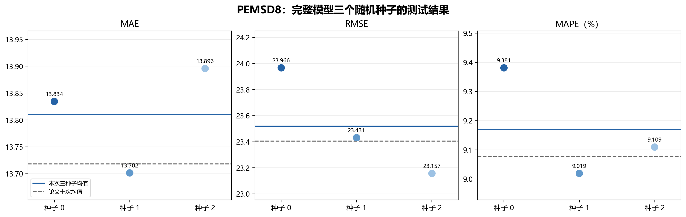
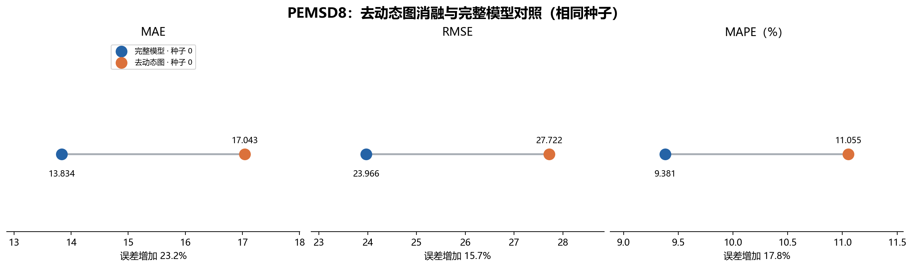
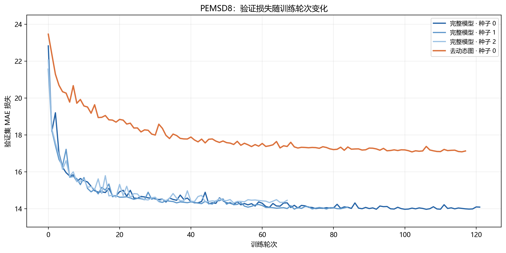

# HSDGNN 在 PEMSD8 上的部分复现

## 目标与依据

- 论文：Zhou 等，*Graph Neural Networks for Multivariate Time-Series Forecasting via Learning Hierarchical Spatiotemporal Dependencies*，*Engineering Applications of Artificial Intelligence*，2025，DOI：[10.1016/j.engappai.2025.110304](https://doi.org/10.1016/j.engappai.2025.110304)。
- 范围：使用作者[官方代码](https://github.com/zhourongleiden/HSDGNN)与其发布的 PEMSD8 数据，按相同配置训练 **3 个随机种子（0、1、2）**；另以种子 0 完成 **1 次去动态图消融**，对照完整模型与论文结果。
- 作者代码版本：`3b83c6a8abb2229bc176c97ac71f7676bbf584d1`。
- 数据 SHA-256：`e1d03ce74e9fb79149e6e7c37c680214822c4a285baa2f42278cacabcd25c075`。

## 环境与设置

| 项目 | 本次设置 |
|---|---|
| 服务器 | Ubuntu 22.04，18 核 CPU，60 GB 内存 |
| GPU | NVIDIA GeForce RTX 4090 D，24 GB 显存 |
| Python / PyTorch / NumPy | 3.10.8 / 2.1.2+cu118 / 1.26.4 |
| 数据形状 | 17,856 个时间点 × 170 个节点 × 3 个原始属性 |
| 输入 / 输出 | 过去 12 步预测未来 12 步，采样间隔 5 分钟 |
| 随机种子 / 批大小 | 0、1、2 / 64 |
| 最大训练轮数 | 300；验证集连续 15 轮未改善则提前停止 |
| 模型参数量 | 578,814 |

训练命令：

```bash
cd /root/autodl-tmp/HSDGNN
python -u main.py --dataset PEMSD8              # 种子 0：配置文件默认值
python -u main.py --dataset PEMSD8 --seed 1
python -u main.py --dataset PEMSD8 --seed 2
python -u main.py --dataset PEMSD8 --seed 0 --without_dynamic_graph
```

作者脚本在读取配置前解析一次命令行，原写法不能接收 `--seed`；将 `main.py` 中第一次 `args.parse_args()` 改为 `args.parse_known_args()`，使种子与消融参数能够通过第一轮解析。消融开关的实现见下文。服务器日志位于 `/root/autodl-tmp/HSDGNN/` 下，文件名见下文。

## 结果对照

| 运行 | MAE ↓ | RMSE ↓ | MAPE ↓ |
|---|---:|---:|---:|
| 种子 0 | 13.834472 | 23.966454 | 9.380860% |
| 种子 1 | 13.701533 | 23.431082 | 9.019061% |
| 种子 2 | 13.895688 | 23.156811 | 9.109393% |
| 本次 3 次均值 ± 样本标准差 | **13.810564 ± 0.099261** | **23.518116 ± 0.411779** | **9.169771% ± 0.188305%** |
| 论文 10 次均值 ± 标准差 | 13.718 ± 0.154 | 23.405 ± 0.137 | 9.077% ± 0.136% |
| 本次均值 − 论文均值 | +0.092564（+0.67%） | +0.113116（+0.48%） | +0.092771 个百分点（+1.02%） |

论文结果见[正文实验表格](https://doi.org/10.1016/j.engappai.2025.110304)。本次标准差按 `n−1` 分母计算。3 次样本数少于论文的 10 次；尤其 RMSE 的本次样本标准差高于论文报告值，因此只能说均值接近，不能断言已复现其波动水平。

## 训练过程与判断

- 三次运行均正常退出，且均由验证集连续 15 轮未改善触发提前停止。种子 0、1、2 分别完成 122、85、68 轮；最佳验证轮次分别为 106、69、52，最低验证损失分别为 13.968836、13.978449、14.311185。
- 训练结束后，官方脚本分别加载各自的最佳模型进行测试。三次运行的 MAE 跨度为 0.194155，RMSE 跨度为 0.809643，MAPE 跨度为 0.361799 个百分点；三项均值均略高于论文的 10 次均值。
- 三个种子的完整训练日志保存在 `../results/logs/`，最佳模型保存在 `../results/checkpoints/`：种子 0 为 `pemsd8_train.log`、`best_model.pth`；种子 1 为 `pemsd8_seed1.log`、`best_model_seed1.pth`；种子 2 为 `pemsd8_seed2.log`、`best_model_seed2.pth`。

## 去动态图消融：种子 0

论文将此变体称为 *HSDGNN w/o DG*（去掉动态图），但官方仓库没有提供对应代码。这里在 `model/HSDGNN.py` 的三个 `HSDGNN_block` 中关闭由输入生成的跨节点邻接矩阵 `supports2` 及其聚合项 `x_g2`，保留单位矩阵路径 `x_g1`、节点专属变换和其余网络；通过 `--without_dynamic_graph` 启用。由于作者未公开消融的具体实现，**本次与论文的消融行只能作方向性参考，不视为同一实现的精确复现**。

| PEMSD8 测试结果 | MAE ↓ | RMSE ↓ | MAPE ↓ |
|---|---:|---:|---:|
| 本次完整模型，种子 0 | 13.834472 | 23.966454 | 9.380860% |
| 本次去动态图，种子 0 | **17.042620** | **27.722179** | **11.055129%** |
| 消融增加的误差 | +3.208148（+23.19%） | +3.755725（+15.67%） | +1.674269 个百分点（+17.85%） |
| 论文 *w/o DG*，10 次运行均值 | 14.740 | 24.094 | 9.660% |

本次消融完成 118 轮，最佳验证轮次为 102，最低验证损失 17.080604；此后连续 15 轮未改善而提前停止。日志与最佳模型分别保存在 `../results/logs/pemsd8_wo_dg_seed0.log`、`../results/checkpoints/best_model_wo_dg_seed0.pth`。消融源码见 `../main.py` 和 `../model/HSDGNN.py`。同种子完整模型三项误差都明显更低，说明本次实现中的跨节点动态图聚合有效；本次消融比论文对应行差得更多，可能与消融实现口径不同有关，不能据此推断论文结果有误。

启动训练前做过两项检查：关闭消融开关时，新旧源码在相同参数初始化下输出完全一致；打开消融开关时，前向与反向计算通过。

## 实验结果图片

以下图片由 `../results/logs/` 中的训练日志生成；图中的消融结果采用本次实现口径。移动本文档时需同时复制 `figures` 文件夹，图片才能继续显示。







## 复现边界

本次只训练 HSDGNN 在 PEMSD8 上的原论文预测任务，以及上述一次自实现的去动态图消融；不包含其他五个数据集、基线模型、其他消融，或将模型迁移到森林火灾任务。训练和评估沿用作者代码的预处理及指标实现。完整模型的三次运行能初步观察种子波动，但不足以充分估计总体方差；消融只有一个种子，尚不能估计其波动。
