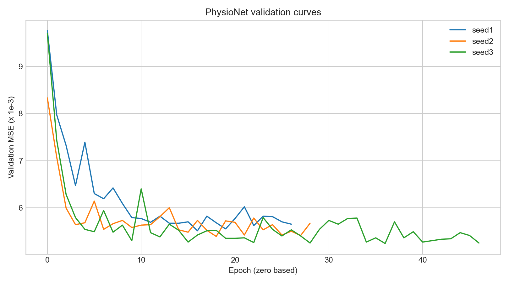
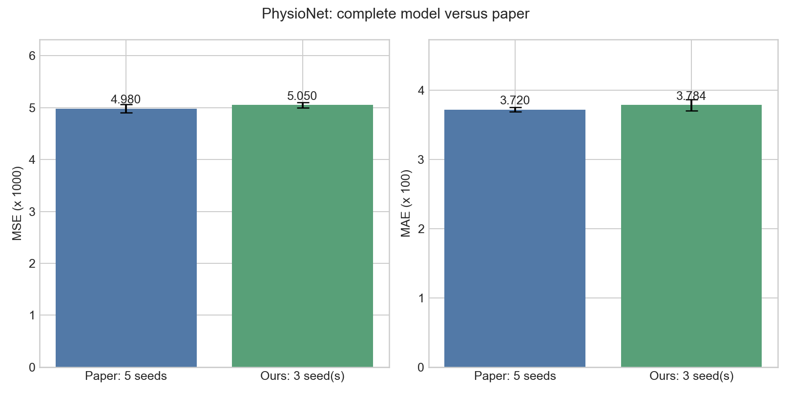
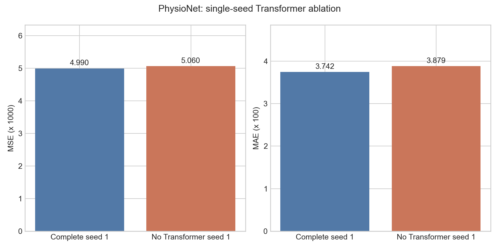

# t-PatchGNN：PhysioNet 复现（轻量公开包）

论文：[ICML 2024 原文](https://proceedings.mlr.press/v235/zhang24bw.html) · [官方代码](https://github.com/usail-hkust/t-PatchGNN)

本包记录单张 RTX 4090 D 上的 PhysioNet 实验：一次流程检查、三个随机种子的完整模型训练，以及一次移除 Transformer 的消融。实验于 2026-10-22 完成。代码中的官方部分来自上述仓库；`source/tPatchGNN_wo_transformer/model/tPatchGNN.py` 是本次实验的改动副本。数据和归档未纳入轻量包。

## 结果

| 实验 | 训练轮数 | 最佳轮次（从 0 计） | 测试 MSE | 测试 MAE |
|---|---:|---:|---:|---:|
| 流程检查（1 轮） | 1 | 0 | 0.00911 | 0.05563 |
| 完整模型 seed 1 | 27 | 16 | 0.00499 | 0.03742 |
| 完整模型 seed 2 | 29 | 18 | 0.00509 | 0.03879 |
| 完整模型 seed 3 | 47 | 36 | 0.00507 | 0.03731 |
| 移除 Transformer，seed 1 | 29 | 18 | 0.00506 | 0.03879 |

完整模型三种子均值 ± 样本标准差：**MSE 0.00505 ± 0.00005，MAE 0.03784 ± 0.00082**。论文完整模型五种子结果为 MSE 0.00498 ± 0.00008、MAE 0.03720 ± 0.00030。本次均值分别高 1.41% 和 1.72%；种子数不同，仅作指标对照。

本次消融与相同种子的完整模型相比，MSE 高 1.40%，MAE 高 3.66%。论文移除 Transformer 的五种子均值为 MSE 0.00510、MAE 0.03830。论文未提供消融脚本；这里跳过 Transformer 及其位置输入，保留图网络，是依据论文描述实现的一次近似对照，不能据此断言显著性。







## 获取数据与重跑

官方处理后的 PhysioNet 数据位于[官方仓库的 `data/physionet/processed.zip`](https://github.com/usail-hkust/t-PatchGNN/tree/main/data/physionet)，约 22 MB。下载后放到 `source/data/physionet/processed.zip`，并在该目录解压，使 `source/data/physionet/processed/` 下存在三个 `set-*_0.0.pt` 文件。请从仓库根目录运行：

```bash
cd source/data/physionet
unzip processed.zip
cd ../../..
pip install -r source/requirements.txt
bash run_physionet.sh
```

上述脚本默认依次运行完整模型的 seed 1、2、3，以及 seed 1 消融；需要 CUDA GPU，输出写入 `run_logs/`，官方训练日志写入各代码目录的 `logs/`。服务器实测环境为 Python 3.10.8、PyTorch 2.1.2+cu118、RTX 4090 D；`source/requirements.txt` 是官方依赖清单，指定的 PyTorch 版本与实测环境不完全相同。数据划分为 7200/2400/2400；主要参数为 history 24、patch_size/stride 8、batch_size 32、学习率 0.001、patience 10。运行脚本提供完整参数。

## 包内文件

- `run_summary.csv`、`summary.json`：逐次测试结果和论文对照数值；`epoch_metrics.csv`：逐轮指标。
- `figures/`：三张结果图；`make_results.py`：由归档日志重新生成结果表和图片的脚本（不会覆盖本 README）。
- `reproduction_logs/` 与 `logs/`：当时的控制台输出、退出状态及官方训练日志；其中旧 `run_*.sh` 带有当时服务器的绝对路径，仅作历史记录。重跑请使用根目录的 `run_physionet.sh`。
- `source/`：官方训练与数据读取代码、独立的消融代码副本；来源见[官方仓库](https://github.com/usail-hkust/t-PatchGNN)。

官方训练入口未实际保存模型权重，因此本包不含 checkpoint，也无法直接加载已训练模型。请复制整个文件夹，README 的相对路径图片才能保持显示。
