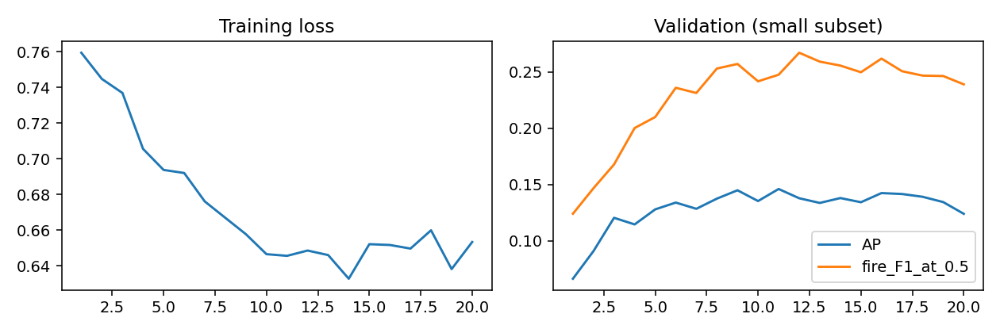

# CanadaFireSat：小规模复现

已完成作者CNN多模态模型的公开权重推理，以及512个训练样本、128个验证样本上的20轮重训。模型输入为多光谱影像序列和环境数值序列。

**这是Alberta小子集的流程复现，不是论文全国主表复现，也未提出新算法。**

| 模型 | 验证AP | 火灾F1@0.5 |
|---|---:|---:|
| 作者公开火灾权重 | 22.58% | 25.07% |
| 小样本重训，第11轮，按验证AP选择 | 14.60% | 24.76% |

两者使用同一验证子集，训练数据规模不同，不能据此比较新算法优劣。AP为sklearn average_precision_score；本次不是在2023独立测试集上评价。



## 先看哪些文件

- [复现结果说明](results/reports/复现结果说明.md)：实验范围、结果与局限。
- [官方权重预测解读](results/reports/第一步_官方权重推理解读.md)：怎样理解四幅预测图。
- [逐轮指标](results/metrics/history.csv)与[完成记录](results/metrics/completion.json)。
- [轻量包与原包对比](docs/LITE_VS_FULL.md)：实际体积、保留/排除内容及功能差异。
- `configs/`：数据版本、训练/验证样本清单、配置、环境约束及兼容补丁。
- `official/`：所需上游源码及配置，已应用兼容补丁；**无需再克隆子模块**。

## 在新的Linux GPU机器上重跑

原运行环境：Python 3.10.8、PyTorch 2.1.2+cu118、torchvision 0.16.2+cu118、RTX 4090D。先准备可用的CUDA版PyTorch环境，再从仓库根目录执行：

```bash
python -m venv --system-site-packages .venv
source .venv/bin/activate
python -m pip install -r requirements.txt
python -c "import torch; print(torch.__version__, torch.cuda.is_available())"
export HF_HUB_DISABLE_XET=1
python -u scripts/download_subset.py
python -u scripts/run_small.py
```

下载脚本按清单中的固定版本获取原数据分片、作者权重及元数据，约5.87GB。重训还会通过timm下载约102MB的ImageNet初始化权重，其原运行版本记录在 `configs/imagenet_source.json`。脚本没有自动锁定timm的远端main；追求原初始化版本时，应结合该记录准备缓存。这一点不影响本包保存的已完成结果。

新运行输出位于 `outputs/`，不覆盖已归档的 `results/`。实际需要网络、GPU和额外磁盘空间；本包没有包含可直接加载的本次重训权重。`configs/checkpoint_sha256.txt`记录的是原训练产物校验值，不能要求重新训练得到相同文件哈希。

训练沿用作者架构、损失与数据变换，样本子集由种子42选取。GPU计算与环境差异可能影响重训数值。不要设置 `REUSE_OFFICIAL_INFERENCE=1`，除非已有同一数据清单和种子的推理结果。

